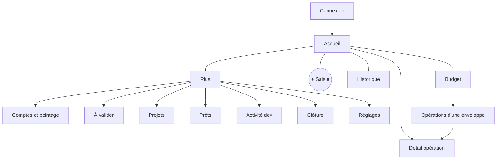

# App flow — Suivi financier

Navigation map and step-by-step user flows. Rules referenced as `R#` live in `docs/spec.md`; visual rules in `docs/design-brief.md`. Each flow is tagged with the phase that delivers it. UI text is French.

---

## 1. Navigation map

### Phone (< 1024 px)

Bottom bar: Accueil · Budget · **+** · Historique · Plus. The **+** opens Saisie rapide as a full-screen sheet from any tab.

### Desktop (≥ 1024 px)

Sidebar, top to bottom: Accueil · À valider · Journal · Budget · Récurrents · Comptes · Projets · Prêts · Activité dev · Historique · Clôture · Réglages. The `+ Opération` button sits in the top bar of every screen.

### Phase availability

| Screen | Phase |
| --- | --- |
| Connexion, Accueil (basic), Saisie rapide, Journal, Budget, Comptes et pointage, Réglages › Import | 1 |
| À valider, Récurrents, Projets, Historique, Clôture, Accueil (reste/jour, prévision) | 2 |
| Prêts, Activité dev (full), bot entry | 3 |

Entries not yet delivered are hidden, not disabled.

---

## 2. Flows

### F1 — Sign in and session (Phase 1, P1.4/P1.6)

1. Open the app → no valid session → **Connexion** (password only, single account).
2. Correct password → **Accueil**. Session: long on phone, short on desktop (PROJECT §Security).
3. Wrong password → `Mot de passe incorrect.`; after repeated failures → `Trop de tentatives. Réessaie dans quelques minutes.`
4. Session expires mid-task → the pending form is kept in memory, **Connexion** opens as a sheet, and after sign-in the user returns to the same form with its values.

### F2 — Quick entry of an expense or income (Phase 1, P1.6)

1. Tap **+** → Saisie rapide opens with the keypad focused, date = today.
2. Type the amount → hero amount updates (`10 000 XAF`).
3. Pick a category chip → class, envelope and budget month are derived and shown on the derived line (R2, R3). Fields that do not apply are hidden.
4. Pick an account chip (preselected from the last use of that category).
5. Optional: label, date change, budget-month override (behind `Plus d'options`).
6. Conditional fields appear only when the class needs them: project (Projet), loan person (Prêt), client + usage (toggle `Activité dev`, Phase 3).
7. **Enregistrer** → validated server-side → toast `Opération enregistrée` + `Annuler` → sheet closes, Accueil updates.

Edge cases:
- Amount 0 → button disabled.
- Invalid combination returned by the server → message on the field concerned, form kept.
- Category in a closed month → `Ce mois est clôturé.` with the option to change the date.
- Double tap on Enregistrer → one operation only (idempotent submit).

### F3 — Transfer between own accounts (Phase 1, P1.6)

1. In Saisie rapide pick a transfer category (`Chargement du pot`, `Retrait espèces`, `Recharge carte`, `Renfort`).
2. Source and destination account chips appear; they must differ (R2).
3. Derived line shows `Transfert · neutre` — no envelope impact.
4. `Chargement du pot` dated on or after the 25th → budget month = next month (R3), shown on the derived line.
5. **Enregistrer** → as F2.

### F4 — Review and correct (Phase 1, P1.7)

1. Desktop **Journal**: filters month · account · category · class · text; newest first.
2. Click a row → inline edit (date, label, amount, category, account) or detail dialog.
3. Save → change recorded in the history log; toast `Modification enregistrée`.
4. Delete → confirm dialog `Supprimer cette opération ?` → soft delete; toast with `Annuler`.
5. Rows in a closed month are read-only with a `Clôturé` badge.

### F5 — Budget of the month (Phase 1, P1.7)

1. **Budget** shows envelopes for the selected month with spent / budget bars.
2. Project purchases appear in a separate block, never inside envelopes (R7).
3. Tap an envelope → its operations (F4 rules apply).

### F6 — Weekly balance check / pointage (Phase 1, P1.8)

1. **Comptes et pointage** → one row per account: theoretical balance, last check date.
2. Tap `Pointer` → enter the real balance from the bank app or cash count.
3. Gap = real − theoretical.
   - Gap 0 → `Compte à jour`, check recorded.
   - Gap within tolerance (cash ≤ 5 000) → `Écart toléré`, check recorded, optional adjustment.
   - Gap above tolerance → two choices: `Chercher l'opération oubliée` (opens Saisie rapide pre-set with that account and the gap amount) or `Créer un ajustement` (operation `Ajustement`, R12).
4. Re-check after correction → gap 0 → recorded.

### F7 — Import of the Excel v9.3 file (Phase 1, P1.9)

1. Desktop **Réglages › Import** → choose the `.xlsx` file from `local-data/`.
2. Preview: rows mapped, corrections proposed (spec §Migration), rows in error highlighted.
3. User accepts or edits each proposed correction.
4. **Importer** → operations created as validated; summary `46 opérations importées, 9 corrections appliquées`.
5. Enter opening balances at 2026-10-01 per account → first pointage (F6).
Import is idempotent: running it twice does not duplicate operations.

### F8 — Inbox / À valider (Phase 2)

1. Recurring templates create drafts on their due date (R11); the Accueil and sidebar show the count.
2. **À valider** lists drafts; each row: `Valider` or edit amount then validate.
3. Desktop: select several → `Valider la sélection`.

### F9 — Salary day (Phase 2)

1. On the 29th: drafts for Salaire, Épargne (30 % proposed, editable, R6), Chargement du pot, Retrait espèces.
2. Validate the four → savings rate and pot du mois update for the next budget month.

### F10 — Project purchase from savings (Phase 2)

1. Transfer `BGFI épargne → Carte prépayée` linked to the project.
2. Purchase with category `PC / Projet`, project required (R7).
3. Projects screen updates spent total; if the month's purchases exceed the month's savings, banner `X prélevés sur l'épargne accumulée`.

### F11 — Monthly close (Phase 2, R13)

Wizard, steps blocking in order:
1. Drafts of the month validated or deleted.
2. All accounts checked after the last day of the month (F6).
3. Items `À vérifier` reviewed.
4. Leftover: `Virer vers l'épargne` or `Garder sur courant` (R8).
5. `Clôturer le mois` → month locked; summary card with savings rate, gaps, envelopes flagged as underestimated.
Reopening is desktop-only, confirmed, and logged.
